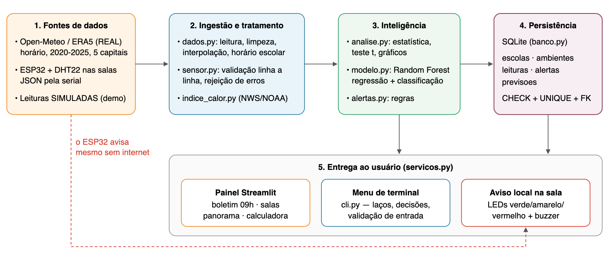

<p align="center">
  
</p>

<p align="center"><a href="README.md">Português</a> · <b>English</b></p>

# Brisa: heat-risk alerts for public schools

Brisa forecasts how hot the afternoon will be inside a school, measures the classrooms with low-cost sensors and tells the coordination team what to do before the heat peaks.

> **Academic project.** FIAP Global Solution 2026.2 (CitizenTech), Artificial Intelligence degree, class 1TIAO. Built by a team of five: Bruna Collavite, Fabio Guntovitch, Fabrizzio Riccelli, Gabriel Tamais and Natasha Zonta. The weather data is real; the school, its rooms and the indoor readings are simulated and labeled as such everywhere.

| Report | Video | Notebook | Dashboard | Firmware |
|:---:|:---:|:---:|:---:|:---:|
| [PDF (Portuguese)](docs/Brisa_GS2026-2_Relatorio.pdf) | [YouTube, unlisted](https://youtu.be/n7Hw76BX5kE) | [Analysis and models](notebooks/brisa_analise_exploratoria.ipynb) | [`src/app.py`](src/app.py) | [`src/esp32/`](src/esp32/) |

## Problem

Extreme heat already disrupts classes. According to UNICEF, heatwaves were the climate event that affected schooling the most worldwide in 2024, reaching about 171 million students. In Brazil, many public-school classrooms have no air conditioning, and children spend four to seven hours a day in them. The coordination team has to decide **before the afternoon** whether to move classes, cancel outdoor physical education or reinforce hydration, and today that decision is made without data.

## Solution

1. **A 9 a.m. bulletin.** Using the morning conditions (temperature, humidity, radiation, wind and yesterday's peak), a Random Forest predicts the heat-index peak between 12 p.m. and 5 p.m., the risk band and practical recommendations.
2. **Classroom sensors.** An ESP32 with a DHT22 measures temperature and humidity, computes the heat index on the device, drives LEDs and a buzzer, and sends JSON readings to the backend. The room gets the warning even without internet.
3. **Backend and dashboard.** Python validates and stores the readings in SQLite, raises alerts without flooding people with notifications and points to the coolest room to receive a class. Streamlit serves the dashboard.

<p align="center"></p>

## Results

Real hourly weather data from 2020 to 2025 for five state capitals, one per region (263,040 records):

| Measure | Result |
|---|---|
| School hours with heat index ≥ 32.2 °C ("extreme caution" or worse) | Teresina 61%, Manaus 50%, Cuiabá 45%, Rio de Janeiro 15%, São Paulo 1% |
| Daily peak, 2023–2025 vs 2020–2022 | +1.0 to +1.4 °C in all five cities (Welch's t-test, p < 0.001) |
| Peak regression, test set 2024–2025 (Random Forest) | MAE **1.33 °C**, R² **0.889** (persistence baseline: MAE 1.85 °C) |
| Risk-band classification, test set 2024–2025 | Accuracy **83.6%**, macro F1 0.726 (baseline: 78.0%, 0.665) |
| Early "Danger" warning, calibrated threshold | Recall 86.8% (66 of 76 days), precision 23.5% |
| ESP32 firmware on Wokwi | On-chip index matches Python within 0.05 °C; output accepted by the backend |
| Automated tests | 32 of 32 passing |

The low precision of the "Danger" warning is a deliberate trade-off, explained below.

## Technical decisions

- **NWS/NOAA heat index (Rothfusz equation).** A public, documented metric that combines the two quantities a cheap DHT22 sensor measures. Official bands keep the alerts auditable.
- **Real data from Open-Meteo (ERA5).** Free, no sign-up, complete hourly series for any coordinate in Brazil. One capital per region tests whether the model generalizes.
- **Time-based validation.** Models are trained on 2020–2023 and tested on 2024–2025, never on shuffled days, which mirrors real use and avoids leakage. Random Forest was compared with linear and logistic regression, a decision tree and a persistence baseline ("today equals yesterday").
- **Recall over precision for "Danger".** The class is rare (2.9% of test days) and the costliest to miss. The threshold was chosen on 2021–2023 validation data, never on the test set. An extra hydration break is cheaper than a missed dangerous afternoon.
- **The backend recalculates.** The device computes the index for the local alarm, but the server recomputes it and does not trust the value it receives. SQLite `CHECK` constraints reject impossible readings.

## Getting started

Requires Python 3.10 or newer.

```bash
git clone https://github.com/fabrizzioriccelli/brisa-heat-alert.git
cd brisa-heat-alert
python -m venv .venv && source .venv/bin/activate   # Windows: .venv\Scripts\activate
pip install -r requirements.txt

python src/main.py tudo          # full pipeline: prepare, analyze, train, demo (~30 s)
streamlit run src/app.py         # dashboard at http://localhost:8501
python src/main.py boletim --cidade teresina --data 2024-10-08   # one day's bulletin
python -m pytest -v              # 32 tests
```

The real data is already in `data/raw/`; `python src/main.py baixar` downloads it again. The command names are in Portuguese, like the rest of the code. To run the firmware, open a new ESP32 project on [wokwi.com](https://wokwi.com), add `sketch.ino`, `brisa_ic.h` and `diagram.json` from [`src/esp32/`](src/esp32/), and install the "DHT sensor library for ESPx".

## Project structure

```text
data/        real (raw/), processed and simulated data, plus the SQLite database
docs/        report, video script and subtitles, brand, figures and execution evidence
models/      trained models (.joblib) and metrics
notebooks/   exploratory analysis, statistics and modeling (already executed)
src/
├── main.py  entry point: pipeline, demo, bulletin and terminal menu
├── app.py   Streamlit dashboard
├── brisa/   data, heat index, analysis, model, database, sensor, alerts, services
└── esp32/   firmware and Wokwi circuit
tests/       pytest suite
```

## Limitations and next steps

- The school, its rooms and the indoor readings are simulated. A pilot in one real school would show how indoor temperature relates to the outdoor forecast.
- The model uses one capital per region; smaller cities may behave differently.
- The trained models are 10 MB and 18 MB `.joblib` files committed to the repository. They can be regenerated with `python src/main.py tudo`; Git LFS or a release asset would be the next step.

## My part

I built the technical work in this repository end to end, with Claude Code as my coding assistant: data collection and preparation, the statistical analysis, the models and their evaluation, the ESP32 firmware and Wokwi circuit, the Python backend and SQLite database, the Streamlit dashboard, the test suite, the visual identity, the report and this documentation.

## License

Released under [CC BY 4.0](http://creativecommons.org/licenses/by/4.0/), following the FIAP template.
