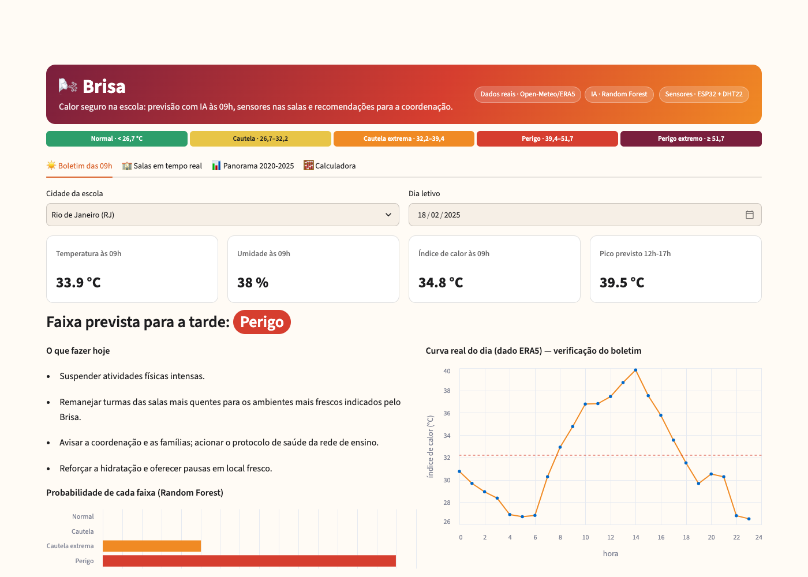
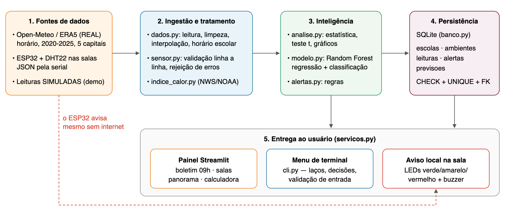
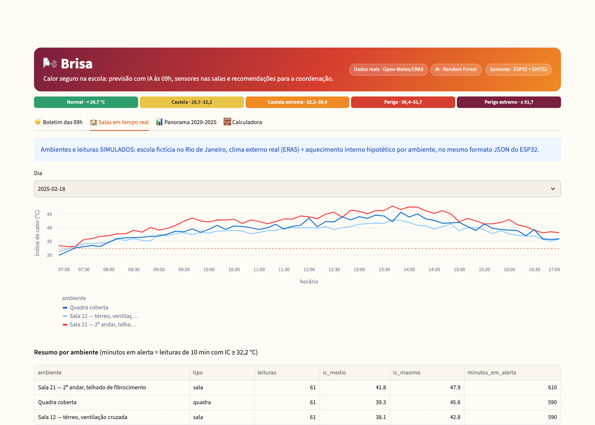
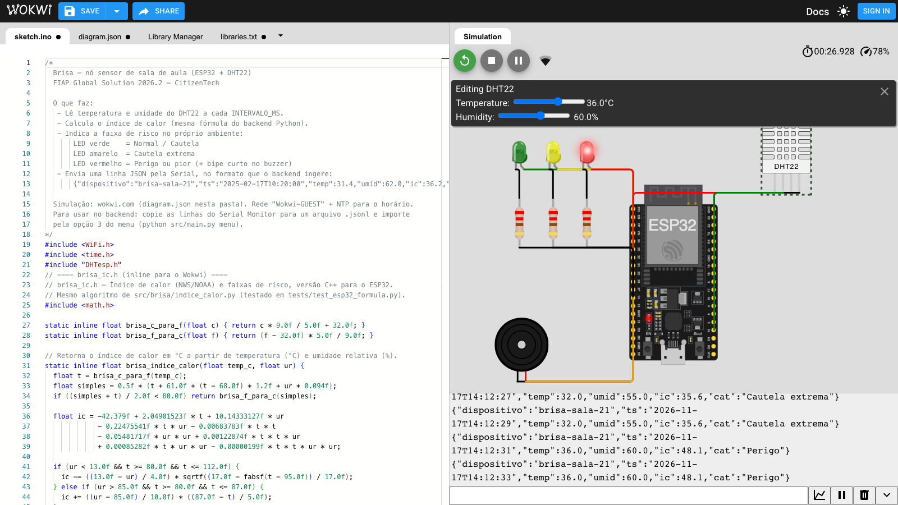

# FIAP - Faculdade de Informática e Administração Paulista

<p align="center">
<a href="https://www.fiap.com.br/">
  
</a>
</p>

<br>

# 🌬️ Brisa — calor seguro na escola

**Global Solution 2026.2 · CitizenTech: tecnologia centrada no cidadão**
Graduação em Inteligência Artificial (FIAP ON) · 1TIAO · Fase 3

<p align="center">
  
</p>

| 📄 Relatório | 🎬 Vídeo | 📓 Notebook | 🖥️ Painel | 🔌 ESP32 |
|:---:|:---:|:---:|:---:|:---:|
| [PDF de entrega](docs/Brisa_GS2026-2_Relatorio.pdf) | [YouTube (não listado)](http://url-aqui) | [Análise e modelos](notebooks/brisa_analise_exploratoria.ipynb) | [`src/app.py`](src/app.py) | [`src/esp32/`](src/esp32/) |

## 👨‍🎓 Integrantes: 
- <a href="https://github.com/brunacollavite">Bruna Collavite</a> — RM 576285
- <a href="https://github.com/Guntooo">Fabio Guntovitch</a> — RM 575582
- <a href="https://github.com/fabrizzioriccelli">Fabrizzio Riccelli</a> — RM 576083
- <a href="https://github.com/GabrielTamaisFischer">Gabriel Tamais</a> — RM 574503
- <a href="https://github.com/natashazont">Natasha Zonta</a> — RM 574230

## 👩‍🏫 Professores:

### Tutor(a)
- <a href="Link do perfil no LinkedIn">[Nome do Tutor]</a>
  
### Coordenador(a)
- <a href="https://www.linkedin.com/in/andregodoichiovato/">André Godoi Chiovato</a>

## 📜 Descrição

### O problema
O calor extremo já interrompe e prejudica as aulas. Segundo o UNICEF, ondas de calor foram o evento climático que mais afetou a escolarização no mundo em 2024, com cerca de **171 milhões de estudantes** atingidos. No Brasil, um estudo publicado na PLOS ONE (2024) estimou **48.075 mortes** atribuíveis a ondas de calor entre 2000 e 2018 em 14 regiões metropolitanas. Mesmo assim, a maior parte das escolas não sabe **quanto calor faz dentro de cada sala** e só reage quando alguém passa mal.

### Para quem
- **Crianças e adolescentes** da rede pública, que passam de 4 a 7 horas por dia em salas muitas vezes sem climatização.
- **Professores e equipe**, que trabalham nas mesmas condições.
- **Coordenação escolar**, que precisa decidir *antes da tarde* se remaneja turmas, suspende a educação física ao ar livre ou reforça a hidratação.

### A solução
O **Brisa** une previsão, medição e ação:

1. **Boletim das 9h com IA:** com os dados da manhã (temperatura, umidade, radiação, vento e pico de ontem), um modelo **Random Forest** prevê o pico do índice de calor entre 12h e 17h e a faixa de risco, com recomendações práticas.
2. **Sensores nas salas (ESP32 + DHT22):** medem temperatura e umidade, calculam o índice de calor no próprio dispositivo, acendem LEDs e um buzzer e enviam leituras JSON ao backend.
3. **Backend Python + SQLite + painel:** valida as leituras, grava no banco, gera alertas sem excesso de notificações e indica o ambiente mais fresco para receber turmas.

<p align="center"></p>

### Principais resultados
Dados meteorológicos **reais**, horários, de 2020 a 2025, em 5 capitais (263.040 registros):

| Indicador | Resultado |
|---|---|
| Horas de aula com índice de calor ≥ 32,2 °C (*Cautela extrema* ou pior) | Teresina 61%, Manaus 50%, Cuiabá 45%, Rio de Janeiro 15%, São Paulo 1% |
| Pico diário: 2023–2025 contra 2020–2022 | +1,0 a +1,4 °C nas 5 cidades (teste t de Welch, p < 0,001) |
| Regressão do pico, teste 2024–2025 (Random Forest) | MAE **1,33 °C**, R² **0,889** (linha de base: MAE 1,85 °C) |
| Classificação da faixa, teste 2024–2025 (Random Forest) | Acurácia **83,6%**, F1-macro 0,726 (linha de base: 78,0%, 0,665) |
| Aviso preventivo de *Perigo* (limiar calibrado) | Recall 86,8% (66 de 76 dias); precisão 23,5% |
| Firmware ESP32 executado no Wokwi | Índice no chip = Python (diferença < 0,05 °C); saída aceita pelo backend |
| Testes automatizados | **32 de 32 passando** |

### Demonstração

| Boletim das 9h | Salas em tempo real (simulado) | ESP32 no Wokwi |
|:---:|:---:|:---:|
|  |  |  |

### ODS relacionados
**ODS 3** (Saúde e bem-estar), **ODS 4** (Educação de qualidade), **ODS 11** (Cidades e comunidades sustentáveis) e **ODS 13** (Ação contra a mudança global do clima). O relatório traz as metas de cada ODS e os indicadores propostos para medir o impacto.

## 📁 Estrutura de pastas 

```
GLOBAL-SOLUTION-1/
├── data/        dados reais (raw/), tratados (processed/), simulados (simulated/) e banco brisa.db
├── docs/        relatório PDF, roteiro do vídeo, figuras (img/) e evidências de execução e testes
├── models/      modelos treinados (.joblib) e métricas (metricas.json)
├── notebooks/   análise exploratória, estatística e modelagem (já executado)
├── src/
│   ├── main.py      ponto de entrada: pipeline, demonstração, boletim e menu
│   ├── app.py       painel web (Streamlit)
│   ├── brisa/       pacote Python: dados, indice_calor, analise, modelo, banco,
│   │                sensor, alertas, servicos, cli, config
│   └── esp32/       firmware (sketch.ino, brisa_ic.h) e circuito Wokwi (diagram.json)
├── tests/       testes automatizados (pytest)
└── README.md
```

* **`data/`**: a origem e as limitações de cada base estão em [`data/README.md`](data/README.md).
* **`docs/`**: [relatório](docs/Brisa_GS2026-2_Relatorio.pdf), [roteiro do vídeo](docs/roteiro_video.md) e evidências: [testes](docs/evidencia_testes.txt), [pipeline](docs/evidencia_execucao_pipeline.txt), [menu](docs/evidencia_menu_cli.txt), [serial do ESP32](docs/evidencia_wokwi_serial.jsonl) e [ingestão do ESP32](docs/evidencia_wokwi_ingestao.txt).

## 📎 Links e Observações

### 🔗 Links do Projeto

* **[Vídeo demonstrativo no YouTube (não listado)](http://url-aqui)**: 4min17s, com legendas.
* **[Relatório em PDF](docs/Brisa_GS2026-2_Relatorio.pdf)**: documento de entrega, com Introdução, Desenvolvimento, Resultados, Conclusões e a checklist dos requisitos da FIAP.
* **[Firmware e circuito do ESP32](src/esp32/)**: executado no simulador Wokwi, com a saída registrada em [`docs/evidencia_wokwi_serial.jsonl`](docs/evidencia_wokwi_serial.jsonl).

### 🧠 Decisões Técnicas

> **Índice de calor do NWS/NOAA (Rothfusz).** É uma métrica pública, documentada e auditável, que combina temperatura e umidade, as duas grandezas que um sensor barato (DHT22) mede. As faixas oficiais (26,7 / 32,2 / 39,4 / 51,7 °C) viram regras de decisão claras para a escola.
>
> **Dados reais da Open-Meteo (ERA5).** A API é gratuita, não exige cadastro e entrega séries horárias completas para qualquer coordenada do Brasil. Usamos uma capital de cada região para testar se o modelo generaliza.
>
> **Random Forest com validação temporal.** Comparamos com Regressão Linear, Regressão Logística, Árvore de Decisão e uma linha de base de persistência ("hoje igual a ontem"). O Random Forest teve o menor erro e o melhor F1-macro. O treino usa 2020–2023 e o teste usa 2024–2025, para simular o uso real e evitar vazamento de dados.
>
> **Aviso preventivo de Perigo.** A classe *Perigo* é rara (2,9% dos dias de teste) e é a mais importante. O limiar foi escolhido por validação temporal (2021–2023), nunca no teste. Aceitamos mais alarmes falsos em troca de recall, porque o aviso pede vigilância, não suspensão de aulas.
>
> **SQLite.** É um banco relacional sem servidor, com chaves estrangeiras e regras `CHECK` que recusam leituras impossíveis. Basta para uma escola e migra para PostgreSQL se o projeto crescer.
>
> **ESP32 com cálculo no dispositivo.** A sala recebe o aviso (LEDs e buzzer) mesmo sem internet. O backend **recalcula** o índice e não confia no valor enviado.
>
> **Streamlit + menu de terminal.** O painel atende a coordenação. O menu exercita os fundamentos de Python do curso (laços, decisões, validação de entrada).

### 📢 Observações Gerais

* **Participação na Competição:** [ ] Sim, aceitamos participar / [x] Não vamos participar.
* *Outras observações gerais:* tudo que é **simulado** (a escola, seus ambientes e as leituras internas) está identificado assim no código, no banco (`origem = 'simulado'`, `simulada = 1`), no painel, no vídeo e no relatório. As análises e os modelos usam apenas dados meteorológicos **reais**.

## 🔧 Como executar o código

**Pré-requisitos:** Python 3.10 ou superior (testado no 3.15) e Git. Para o firmware, o simulador online [Wokwi](https://wokwi.com) ou uma placa ESP32 com DHT22.

```bash
# 1. Clonar e entrar na pasta da entrega
git clone https://github.com/fabrizzioriccelli/FIAP-PORTFOLIO-AI.git
cd FIAP-PORTFOLIO-AI/1TIAO/GLOBAL-SOLUTION-1

# 2. Ambiente virtual e dependências
python -m venv .venv
source .venv/bin/activate            # Windows: .venv\Scripts\activate
pip install -r requirements.txt

# 3. Pipeline completo: preparar → analisar → treinar → demonstração (cerca de 30 s)
python src/main.py tudo

# 4. Painel web (abre em http://localhost:8501)
streamlit run src/app.py

# 5. Menu interativo de terminal
python src/main.py menu

# 6. Boletim de um dia específico
python src/main.py boletim --cidade teresina --data 2024-10-08

# 7. Testes automatizados
python -m pytest -v
```

Os dados reais já estão em `data/raw/`. Para baixá-los de novo: `python src/main.py baixar`.

**ESP32 no Wokwi:**
1. Crie um projeto "ESP32" em [wokwi.com](https://wokwi.com).
2. Cole o `sketch.ino`, crie o arquivo `brisa_ic.h` e substitua o `diagram.json` pelos desta pasta.
3. Adicione a biblioteca **DHT sensor library for ESPx** e rode a simulação. Clique no DHT22 para mudar temperatura e umidade.
4. Para levar as leituras ao backend, copie as linhas JSON do Serial Monitor para um arquivo `.jsonl` e use a opção 3 do menu.

---

## 📋 Licença

<p xmlns:cc="http://creativecommons.org/ns#" xmlns:dct="http://purl.org/dc/terms/"><a property="dct:title" rel="cc:attributionURL" href="https://github.com/fiap-tutoria/FIAP-PORTFOLIO-AI">TEMPLATE - FIAP PORTFÓLIO AI</a> por <a rel="cc:attributionURL dct:creator" property="cc:attributionName" href="https://fiap.com.br">FIAP</a> está licenciado sobre <a href="http://creativecommons.org/licenses/by/4.0/?ref=chooser-v1" target="_blank" rel="license noopener noreferrer" style="display:inline-block;">Attribution 4.0 International</a>.</p>
